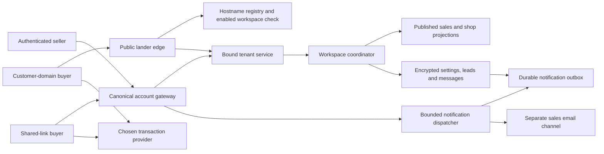

# Architecture and contracts

## 1. Verified source map and reuse

All paths below are relative to the repository. This is the inspected baseline, not a claim that proposed modules already exist.

| Existing source | Reuse / required change |
| --- | --- |
| `src/shared/ipc.ts`, `list-prices.ts`, `money.ts`; `src/core/services/list-prices.ts` | Canonical private asking prices, minimum offers and floors already exist; retain normalization and whole-amount validation |
| `src/shared/domain-catalog.ts`, `src/core/services/domain-events.ts`, `domain-import.ts` | Inventory identity, registrar-action authority, imported names and sold/departed history; CSV is not ownership proof |
| `src/renderer/pages/DomainWorkspace.tsx`, `Domains.tsx`, `Renewals.tsx` | Existing inventory, filters, bulk workflow and renewal information; add selling views without forking inventory |
| `src/shared/owner-site.ts`, `publication.ts`, `src/core/publication/*` | Explicit selection and public projection concepts; retain v1/v2 readers and independent old publications |
| `src/worker/publication-store.ts` | Encrypted private drafts, SQL revision checks and public-only payloads; extend the pattern rather than putting every sales object in the one `main` site document |
| `src/worker/public-portfolio.ts`, `index.ts` | Public reads occur before private store hydration; preserve this boundary for landers |
| `src/hosted/gateway.ts`, `tenant.ts`, `workspace-coordinator.ts`, `src/shared/gateway-proof.ts` | Canonical origin, explicit anonymous routes, service bindings, signed tenant admission and coordinated private state |
| `src/hosted/registration.ts`, `email-auth.ts` | Auth mail currently has separate readiness checks and a 30/day, 300/month budget in code; sales mail must not consume or weaken it |
| `src/worker/publication-backup.ts`, `src/core/storage/bundle.ts` | Host-specific backup extension exists; add sales data with explicit version handling, no automatic publication or replay on restore |
| `scripts/dombot-engine.mjs`, `hosted/dombot-engine.lock.json`, `vendor/*engine*` | Tenant runtime uses a pinned engine artifact; editing root source alone does not change the consumed tenant runtime |

The current hosted public-path allowlist covers `/p/:handle` and collection paths. The gateway also enforces the canonical origin before dispatch. Therefore customer hostnames need a purpose-built public edge entry point, not a blanket exception around all account routes.

## 2. Boundaries and topology



The public edge has no account sessions, registrar credentials or payment collection. Its only domain routing authority is the control-plane registry. It strips caller-supplied tenant/proof headers and cookies, resolves the hostname itself, and constructs a new signed tenant request. Unknown or inactive hosts return a generic missing/unavailable page. Never accept a workspace ID, provider redirect URL or hostname claim from a buyer's form as routing authority.

Canonical shared routes use the existing gateway service bindings and workspace-enabled check. Private mutations continue through the coordinator and existing request lock. New public intake uses a narrow sales handler before general boot/hydration: it validates and encrypts the submission using a purpose-derived key, without loading registrar namespaces. Public GET landers query only published rows and operational status; they do not derive private keys.

The coordinator is not a reason to load all leads or all sales documents on every request. New stores use direct paginated D1 queries. Keep slow provider calls and email sends outside private-state critical sections.

## 3. Identity, pricing and public data

Normalize authority to canonical ASCII domain using existing domain-name helpers. Use opaque UUID listing IDs for relationships. Keep account ID plus domain as the exact registrar-action target; do not infer an account from a display label. A domain held in multiple connected accounts is an ownership conflict until resolved.

Existing `ListPrice` remains the default portfolio asking-price source. A sales draft records `priceSource: portfolio | override`. `portfolio` stores a source fingerprint and resolves through that canonical price; `override` contains an explicitly labelled channel/publication price. It does not replace the private portfolio price. Both produce an immutable public price at publication. A changed source fingerprint invalidates a previously prepared review. Floors and costs never enter the public schema.

Use canonical decimal strings and shared currency validation. Initial asking prices and offers follow the existing whole-amount convention; reject unsupported fractions with an explanation. Do not use floating-point arithmetic for fee calculations. Provider estimates have currency, percentage/basis points, fixed/minimum components, conditions, effective date and source. Unknown fees stay unknown. Net proceeds are estimates until the actual settlement is recorded; do not silently subtract tax or convert currencies.

Suggested shared schemas in `src/shared/sales.ts`:

```ts
type SaleMode = 'inquiry' | 'offer' | 'buy-now' | 'external';
type Money = { amount: string; currency: string };
type PriceSource =
  | { kind: 'portfolio'; fingerprint: string }
  | { kind: 'override'; price: Money; reason: string };

interface SaleDraftV1 {
  version: 1;
  id: string;
  domain: string;
  mode: SaleMode;
  displayName: string;
  description: string;
  categories: string[];
  priceSource: PriceSource | null;
  minimumOffer: Money | null;
  destinationId: string | null;
  allowQuestions: boolean;
  sellerDisplayName: string;
  includeInShop: boolean;
}

interface PublishedSaleV1 {
  version: 1;
  id: string;
  domain: string;
  displayName: string;
  mode: SaleMode;
  description: string;
  categories: string[];
  publicPrice: Money | null;
  publicMinimumOffer: Money | null;
  destination: null | {
    provider: string;
    url: string;
    check: 'manual' | 'verified';
    checkedAt: number | null;
  };
  allowQuestions: boolean;
  sellerDisplayName: string;
  revision: string;
  publishedAt: number;
}
```

Parse all objects with strict schemas. The renderer receives `PublishedSaleV1`, never `Domain`, `ListPrice`, `SaleDraftV1`, a lead record, or a registrar object. A separately selected `PublishedShopV1` contains only public listing IDs and shop presentation; public reads recheck that every referenced listing is currently actionable/published. Public search, metadata, structured data and exports use the same allowlist.

`includeInShop` stages a desired change; it does not itself publish or remove a live shop entry. Domain availability suppression does immediately make a listing non-actionable wherever referenced. There is no back door from a collection/project reference to a private listing.

## 4. Persistence and migrations

Proposed additive tenant migrations: `0004_sales.sql` for settings, projections, destinations and events; `0005_sales_inquiries.sql` for leads/messages/tokens/outbox. These filenames are tentative: recheck the migration sequence before creating them. Control-plane migrations are separate, proposed `0006_sales_delivery.sql` and `0007_sales_hostnames.sql` in `hosted/migrations`.

| Store | Key / indexed metadata | Payload and invariants |
| --- | --- | --- |
| `sale_drafts` | `id`, unique domain HMAC, revision, updated timestamp | Sealed strict draft; private settings and unlisted domain association stay encrypted |
| `sale_destinations` | `id`, provider, revision, check status | Sealed exact URL, configuration and optional credential reference; secrets stay in an encrypted credential store |
| `published_sales` | `id`, unique ASCII domain, revision, operational status, publication time | Strict public-only JSON; status separate from content for immediate safety suppression |
| `published_shops` | `id`, handle, revision | Explicit selected public IDs and presentation; existing `published_portfolios` unchanged |
| `sales_leads` | `id`, listing ID, status, verification state, timestamps, buyer-email HMAC | Sealed name/email/message/offer and original public snapshot reference; indexed metadata contains no raw buyer email |
| `sales_messages` | `(lead_id,id)`, sequence, direction, timestamp | Sealed body and recipient; private-note direction is never returned to buyer |
| `sales_tokens` | token hash, purpose, lead ID, expiry, consumed/revoked time | No plaintext capability tokens; separate from account-auth tables and scopes |
| `sales_outbox` | ID, unique dedupe key, lead/message ID, kind, state, attempt count, lease expiry, due time | Sealed delivery content; a durable entry is created in the same transaction as the triggering message |
| `sales_events` | ID, listing/lead ID, kind, actor, timestamp | Sealed details; no credential dumps; bounded retention |
| `sales_jobs` / items | ID, reviewed manifest hash, cursor, status, per-item revision/result | Resumable bulk operations, no implicit retries of successful items |
| Control `sales_hostnames` | globally unique ASCII hostname, immutable workspace/listing ID, binding epoch, status | Challenge hash, provider hostname ID, verification/certificate observations; no buyer records |
| Control sales budgets/receipts | workspace, time bucket, outbox/attempt key, status | Sales-only quotas and delivery receipts; distinct from auth email tables |

Derive encryption/HMAC subkeys with explicit sales-purpose labels from the tenant root through a reviewed extension of `keys.ts`. Do not use raw email or domain names as deterministic encryption keys. Key rotation must re-encrypt payloads and rebuild HMAC indexes. Query exact domains by HMAC; use the already authorized inventory index for partial domain search and then fetch selected summaries in bounded batches. Inbox pagination uses listing/status/time metadata. Defer global free-text search across encrypted message bodies; do not silently add plaintext search copies.

Use bound SQL parameters, foreign keys where supported, unique constraints and compare-and-swap revisions. Conditional writes affecting zero rows are conflicts, not successful transactions. D1 `batch()` provides transactional rollback for SQL errors, but a zero-row update does not itself throw; every dependent write must be conditional on the successful revision marker or use a transaction marker with a checked constraint. [D1 batch documentation](https://developers.cloudflare.com/d1/worker-api/d1-database/).

## 5. State machines and conflict behavior

Keep orthogonal states rather than one overloaded status:

- Content: `none → draft → published`, with `changes-pending` derived by comparison and explicit unpublish.
- Availability: `available | paused | sold | ownership-uncertain | control-lost`.
- Customer hostname: `unconfigured → pending-proof → pending-dns → pending-tls → active`, with `error`, `moved` and `detached` outcomes.
- Destination: `missing | manual | checking | verified | mismatch | expired | unavailable`.
- Lead verification: `pending → verified | expired | blocked`.
- Conversation: `new → negotiating → awaiting-buyer → agreed → closed`, with reopen and spam; agreement alone is not a paid sale.
- Transaction: `not-started | handed-off | payment-reported | transfer-reported | completed | canceled | unknown`; source of each observation is retained.
- Delivery: `queued → leased → accepted | retryable | unknown | failed | suppressed`, plus delivered/bounced only from qualified provider events.

Publication review generates a server-derived manifest containing draft revisions, source-price hashes, destination revisions, shop revision and current ownership observations. Commit accepts only the manifest ID/hash and expected revisions; it recomputes the public projection server-side. Do not accept a buyer/public snapshot supplied by the browser as the authoritative projection. Revalidate all ownership and terms at commit under coordination.

For batches of at most 100 reviewed items, validate all items and commit all intended projection changes atomically within the qualified D1 transaction bound. For larger jobs, explicitly use item-level atomic commits and a resumable manifest; the UI reports partial results. A retry cannot publish an item whose draft, price, ownership, destination or host binding changed since review.

Private Save draft may be optimistic only for reversible visual feedback; publication, DNS activation, seller reply and sold/pause state require acknowledged results. Mark sold/pause first disables actionable public controls and shop results, then records the existing sale/history metadata with an idempotent reconciliation job. A failed metadata update does not reopen the listing. Undo is a new explicit state transition, never an automatic retry.

## 6. API contracts

All paths below are tenant-relative and proposed. Authenticated routes use the existing session, same-origin checks and coordinator. Review/commit return typed `409` conflicts; validation `400`, unauthorized `401/403`, missing `404`, oversized `413`, rate limited `429`, service unavailable `503`. Errors contain actionable field codes, not private payloads.

| Method and path | Contract |
| --- | --- |
| `GET /sales/listings` | Cursor page of sales metadata; authorized domain filter, status and mode; no buyer bodies |
| `POST /sales/listings` | Create private draft for selected existing/verified name; idempotency key |
| `GET /sales/listings/:id` | Draft, revision, published comparison, relevant ownership/destination observations |
| `PUT /sales/listings/:id` | Strict draft + expected revision; no implicit publication |
| `POST /sales/reviews` | IDs + expected revisions; server computes review manifest and expiry |
| `POST /sales/publications` | Manifest + idempotency key; returns item receipts and new public revisions |
| `POST /sales/listings/:id/pause` | Expected operational revision; disables buyer actions everywhere |
| `POST /sales/listings/:id/unpublish` | Expected revision; removes public projection, retains private records |
| `GET/POST /sales/inbox`, `GET /sales/inbox/:id` | List/search by approved metadata and read a thread; POST here is a seller-created private record, never anonymous ingress |
| `POST /sales/inbox/:id/messages` | Strict body, reply/private-note direction, expected thread revision, idempotency key; creates message + outbox transactionally |
| `PATCH /sales/inbox/:id` | Status/follow-up changes with revision; paid-sale claims require source fields |
| `POST /sales/destinations/check` | Check a supported provider link; no general URL fetch proxy |
| `POST /sales/hosts/plans` | Build exact setup/rollback plan without changing DNS |
| `POST /sales/hosts/:id/activate` | Reviewed plan, proof and expected binding epoch; fresh auth for credential/DNS-sensitive operations |
| `GET /d/:domain` | Anonymous canonical lander, published projection only |
| `POST /d/:domain/inquiries` | Bounded anonymous submission tied to the active listing/revision; receipt, never a seller session |
| `GET /i/:token` | Confirmation interstitial; GET does not consume verification or mutate state |
| `POST /i/:token/confirm` | Inquiry-only token, explicit confirmation, idempotent result |
| `GET /t/:token`, `POST /t/:token/messages` | Capability-scoped buyer conversation; no private notes, internal statuses, costs or seller account API |
| `POST /t/:token/resend` | Bounded resend to associated address; generic response |

Canonical public URLs remain `/w/:workspace/d/:domain`, with the tenant prefix inserted by the gateway. Customer-host routes are `/`, `/inquiries`, and strictly defined confirmation/thread paths. Buyer tokens are purpose-bound and resolve only their stored listing and thread. Do not add `/sales/*` or all POSTs to the anonymous gateway allowlist. Update CSP separately for each public page: Turnstile script/frame/connect hosts where used, and only an approved checkout host for a provider form. The current blanket `form-action 'self'` is not sufficient for arbitrary external checkout forms; prefer ordinary labelled links.

## 7. Anonymous inquiry and notification pipeline

Initial tunable pilot defaults: 24-hour inquiry verification token; seven-day buyer-thread capability rotated on resend; a 15-minute publication review manifest; ownership/control observations at most 24 hours old for publish/enable; 100 rows/items per interactive page/review batch. Start abuse limits at five submissions per IP/listing/hour, ten verification emails per recipient/day, three resends per inquiry/hour and five per day. Workspace/global budgets are capped at qualified provider entitlement and the explicitly configured pilot allowance. These are starting controls, not universal buyer-quality assumptions; monitor legitimate shared-network rejections. Retain pending drafts when any limit is hit. Control observations must be refreshed through qualified registrar/DNS checks; CSV upload and a historical lookup never reset their age.

1. Edge resolves an enabled workspace and active published listing. Check availability and the supplied observed revision. A stale-price form receives a review-latest response; its unsent text is retained client-side.
2. Enforce content type, 16 KiB request bound, field limits, honeypot, per-IP/recipient/listing/workspace budgets and server-side Turnstile validation. Bind its action/hostname to the actual page. Tokens are single-use and expire after five minutes; submission idempotency is separate. [Turnstile validation](https://developers.cloudflare.com/turnstile/get-started/server-side-validation/).
3. Atomically create an encrypted pending inquiry, hashed verification token and a verification-mail outbox entry. A request idempotency key is bound to a payload digest; a reused key with different content is rejected. Do not discard a valid inquiry because email transport is down.
4. Best-effort bounded dispatch can follow the response through `waitUntil`, but the durable outbox is the source of truth. A deterministic scheduled drain recovers pending work. The gateway pulls leased batches from bound enabled tenants using an internal notification-purpose proof; this endpoint is not in the public allowlist.
5. Confirmation POST consumes the inquiry token with CAS and enqueues one seller notification. Email scanners following GET links cannot consume it. Resend rotates/revokes the previous verification grant, stays on the same inquiry, and obeys separate quotas.
6. Seller replies create a message and outbox event together. Buyer notification links open the capability-scoped thread. Auth and inquiry tokens, signing purposes and tables are completely separate.

Before repeating single-use Turnstile validation, look up a known request key and verify its matching payload digest under the same route/rate constraints; a matching completed request may return its existing non-sensitive receipt. A new or changed payload must pass validation. This prevents a normal network retry from failing solely because the first request already consumed the challenge. Inquiry/confirmation/thread responses use `Cache-Control: no-store`, `Referrer-Policy: no-referrer`, `X-Robots-Tag: noindex, nofollow`, and no third-party analytics. Strip/redact tokens before diagnostic output. Preserve a valid Origin signal on forms through an explicit policy rather than relying on ambient seller cookies.

Representative inquiry request (the route's domain and trusted edge mapping determine authority):

```json
{
  "observedRevision": "published-revision-uuid",
  "idempotencyKey": "request-uuid",
  "name": "Sample Buyer",
  "email": "buyer@company.example",
  "offer": null,
  "message": "Could we discuss this domain?",
  "turnstileToken": "browser-challenge-token",
  "website": ""
}
```

Successful persistence returns `202` with an opaque receipt ID, `verification-pending`, and whether delivery is queued/temporarily unavailable. It does not echo the email, message, raw token, seller recipient or private floor. A stale public revision returns `409` with `PUBLIC_REVISION_CHANGED` and the current public terms; the buyer reviews and resubmits with a new key. Repeated matching requests return the same receipt. Verification is not a bid acceptance or sale contract, and the copy must not imply that it is.

The dispatcher derives the seller recipient from the verified account/approved recipient record. Initial buyer verification goes only to the submitted email; later messages go only to the thread's associated verified email. No client-supplied arbitrary `to`, `from`, reply headers or email template. Use plain text plus escaped HTML. Default emails contain minimal domain/reference information and a secure link, not the full private conversation. Omit capability URLs and PII from logs and third-party analytics.

Provision a separately qualified sales sender/binding and quota namespace rather than reusing `sendAuthEmail`. Cloudflare arbitrary-recipient sending requires Workers Paid and sender onboarding; current account entitlement, sender readiness and delivery remain prerequisites. Do not purchase/upgrade or claim readiness from repository configuration. [Email Service](https://developers.cloudflare.com/email-service/).

Outbox lease acquisition is atomic, with a lease token required for ACK. Start with a 60-second lease, bounded batches of 10, max five definite-failure attempts with backoff, and explicit retry-after for quotas. Treat an ambiguous send timeout as `unknown`; if the provider offers no qualified idempotency mechanism, do not claim exactly-once email. User-triggered resends are bounded and links remain idempotent. Preserve unknown receipts for reconciliation. Separate accepted by provider from delivered. Sales quota exhaustion never prevents account sign-in emails.

Retention defaults are proposals for operator/product review before collecting new buyer data: pending/unverified inquiries seven days; inactive verified conversations 12 months; short-lived abuse fingerprints 24 hours; minimal suppression hashes 90 days. Seller export/deletion and account closure must cover these stores. No claim that these choices alone establish legal compliance.

## 8. Custom-domain activation and ownership

New `src/hosted/lander-edge.ts` is a small separate Worker entry point used as the Cloudflare for SaaS fallback origin. It cannot expose account login or registrar APIs. Reuse registry/config generation and service-binding admission patterns, not the account gateway's canonical-redirect middleware.

Activation: create claim → verify current account/domain control → reserve globally unique hostname under immutable workspace/listing ID → request provider hostname/certificate → present exact DNS records → observe DNS/certificate/provider state → verify served revision → activate. Keep hostname ownership and certificate states separate. Cloudflare requires active hostname, active TLS and correct routing; a completed API creation is insufficient. [Validation states](https://developers.cloudflare.com/cloudflare-for-platforms/cloudflare-for-saas/domain-support/hostname-validation/validation-status/).

Root domains are a material prerequisite. Support current-DNS apex flattening where qualified. If the DNS provider cannot alias the apex, Cloudflare's apex-proxying option has separate access/cost requirements. Do not promise universal root-domain setup or invent an A-record target. A subdomain-only demo does not qualify apex landers. Do not replace customer nameservers automatically as a workaround. [Apex proxying](https://developers.cloudflare.com/cloudflare-for-platforms/cloudflare-for-saas/start/advanced-settings/apex-proxying/).

DNS changes are plans first: capture A/AAAA/CNAME, MX, TXT, CAA and relevant DNSSEC/delegation observations; show the exact proposed record changes and leave mail/verification records intact. Unknown existing records block automated writes, not manual instructions. Connected registrar actions require the exact live account, current capability and fresh authentication, preserving existing approval semantics. HTTP redirects alone do not provide TLS for an unprovisioned apex.

Every binding has a monotonically increasing epoch. Gateway/edge admission proofs bind intended public purpose, workspace, canonical listing, observed host and epoch in addition to method/path/body. Existing version-1 proofs remain valid only for their existing routes; sales routes require the new explicit claims. Do not trust a forwarded Host header or widen `owner: null` access globally.

Close/disable workspace and loss of control suspend buyer actions and host routing immediately. No long-lived positive cache may bypass that check in the pilot. A stale registrar sync is uncertainty, not proof of loss; after the configured verification window pause actionable sales pending refresh without erasing content. Imported ownership needs DNS proof; fresh CSV upload is not fresh proof. New-owner reassignment requires a new challenge and epoch; never recycle the previous owner's messages or binding grant. Recheck at enablement, publication, domain departure and periodic bounded checkpoints. A return to healthy DNS does not silently republish a sold/unpublished page.

Do not implement a general URL crawler. Provider-link checks use an exact documented host allowlist; custom-domain verification uses provider state, DNS observations and controlled/incoming served-revision receipts. Never fetch arbitrary buyer/seller URLs or follow redirects to private networks. Qualification must explicitly test CAA failures, DNSSEC problems, other-CDN conflicts and provider-domain migration. Preserve DCV challenge paths where required by the Worker-as-origin setup. [Worker as origin](https://developers.cloudflare.com/cloudflare-for-platforms/cloudflare-for-saas/start/advanced-settings/worker-as-origin/).

## 9. Provider adapters and analytics

Adapter interface: capabilities, validate destination, export selected inventory, read observed listing, create checkout handoff, and optional write listing. Every capability is independently qualified and reports unsupported rather than inventing a result. Record desired/submitted/observed values, timestamp, provider ID and source revision. API credentials remain tenant-encrypted and excluded from public payloads/diagnostics.

Stage one supports manual provider links and documented CSV schemas. Stage two qualifies Spaceship listing reads and checkout-link creation against its [public API](https://docs.spaceship.dev/). Batch requests respect documented limits and backoff. Provider write idempotency/reconciliation is mandatory before enabling price writes: after an uncertain timeout read and reconcile before retrying. A checkout-link click is `handoff`, not `paid`. Imported provider receipts and seller-entered outcomes remain labelled by source. Other providers require separate API access evidence and terms; avoid scraping signed-in dashboards as a sync strategy.

Record minimal first-party events: lander served, inquiry persisted/verified, reply queued/accepted, checkout handoff, sale recorded and transfer confirmed. Count known bots separately where possible; do not call all page requests unique human visitors. Do not put buyer emails, thread tokens, full messages or raw IP addresses in analytics. Initial reporting joins durable operational events; an analytics outage cannot affect a submission or transaction state. Any future tracker respects the existing analytics preferences and requires its own configuration decision.

## 10. Backup, restore and compatibility

Extend the existing host backup envelope with a versioned `sales` section containing drafts, destinations without unexportable grants, leads/messages as explicitly selected private data, outcome records and configuration. Update validation and export/restore tests before stores go live. Older consumers must reject an unsupported extension rather than silently drop it. If core namespace formats change, bump `BUNDLE_VERSION` and compatibility readers; do not assume a host-only extension requires no version handling.

Restore validates the entire file first, restores private data only, clears/revokes public projections, review manifests, host activation, capability tokens, provider checkout grants and pending delivery work. It must not resend old messages or republish restored names. Reconcile externally existing host reservations before reclaiming them. Root-key rotation includes every sealed sales row and purpose-HMAC index; inability to rotate is a release blocker.

Desktop can retain existing inventory/price functionality without implementing public ingress. Demo fixtures implement sales UI contracts with explicit sample labels and no network mutations. `supportsSales()` should be a separate capability from `supportsPublishing()` so disabled hosts do not expose a nonfunctional Inbox.
