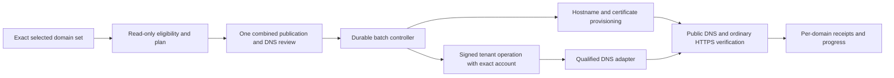

# Bulk lander connection: reviewed implementation and execution handoff

Reviewed 10 November 2026 against hosted main
`1bc5c5f2f2b821f1aa82ce508f5a47d43f698f66`, fetched from
`https://github.com/heathermhuang/dombot.git` during this review.

This is the execution plan. It supersedes the earlier planning choices in
`docs/one-click-lander-plan-20261110.md`. Implementation and live qualification
have not occurred. The interactive previews contain sample data only.

## Authorized outcome and decisions

The user requested: “Review again and Plan the implementation, and finish end to
end from a new thread. And tell me what’s the advantage and disadvantage between
this method and shared domains domains NS server”. Earlier feedback rejected a
complicated per-domain flow and explicitly requested doing many domains at once.

Deliver **Select domains / all matching → Use our lander → Confirm once**.
DNS, ownership, certificates, retries and page checks are background work. The
seller must not repeat setup or approvals for every domain or internal batch.

Implement current-provider DNS updates first, with provider-qualified support
and truthful eligibility. Include the common connection engine and the concrete
shared-NS design described below; operating a new shared authoritative DNS service
is a follow-on, not an unacknowledged dependency of the DNS-first release.
Do not claim either mode supports all registrars or all DNS hosts.

This request authorizes implementation, corrections, appropriate tests, PR,
merge, deployment and controlled qualification through the technical release
milestone. Continue routine authorized work without new small permission gates.
It does not select arbitrary real holdings for a DNS cutover, accept new paid
provider plans, authorize customer outreach, or authorize replacing unrelated
work. Prepare any real hard gate concretely and report exactly what remains.

## Review findings incorporated

1. The previous four-screen illustration exposed internal stages as seller work.
   Replace it with one bulk review and a background results view.
2. The previous flow made publication a separate trip. For unpublished names,
   offer a standard inquiry page with the domain and neutral inquiry action.
   The combined review explicitly approves both its exact public projection and
   the DNS diff. Preserve existing exact publication consent, terms, price and
   control checks beneath that single confirmation. Never auto-publish private
   fields, infer asking prices, or replace existing custom terms silently.
3. Unchanged MX does not prove unchanged email: resolve MX host dependencies,
   SPF `a`/`mx` and routing aliases; check apex-dependent services. Hold affected
   domains instead of claiming email safety.
4. Inspect HTTPS/SVCB, wildcard fallback, DNS-provider forwarding and proxied/CDN
   routing in addition to A/AAAA/CNAME. Old HTTPS/SVCB hints can bypass a changed
   A/CNAME destination. Any necessary modification belongs in the approved diff;
   unsupported/ambiguous routing is an explicit hold.
5. The pinned Cloudflare adapter is not suitable for preservation-safe changes:
   `getDnsRecords` reads one page and `setDnsRecords` deletes/recreates records.
   Use paginated, lossless provider-native record operations. Preserve unrelated
   record IDs, proxy flags, TTLs, comments/tags and other provider attributes.
6. Public DNS cannot enumerate a complete zone. Do not use it as a backup or
   conclude that absent public mail records prove a domain has no other use.
7. A DNS provider is distinct from a registrar. Require authoritative NS evidence
   and the exact account/zone permission. Empty NS evidence must fail closed;
   `registrarHostsDns()` currently treats empty evidence as true and is not an
   automatic-cutover authority check.
8. A working www page does not satisfy a root-domain request. Existing CNAME-only
   Sales plans do not establish a generally usable apex target. Qualify provider
   flattening/ALIAS or a stable service endpoint; never copy resolved edge IPs.
9. Existing Sales jobs are limited to 500 items and their UI advances jobs from
   the browser. Reuse appropriate manifests/receipts, but neither silently cap
   “all matching” to one page nor rely on an open tab for progress.
10. Shared NS is a different trust and operational boundary. It can simplify
    parked-domain onboarding while moving authority for every DNS service to us.
    It does not eliminate TLS, ownership, tenant isolation or recovery work.

## Current DNS versus shared nameservers

| Dimension                | Keep existing authoritative DNS                                              | Domains.Domains authoritative NS                                                     |
| ------------------------ | ---------------------------------------------------------------------------- | ------------------------------------------------------------------------------------ |
| Seller setup             | Connect the actual DNS account; qualify its API                              | Change delegation at the registrar after our zone is ready                           |
| Large parked portfolios  | Multiple DNS hosts/adapters can add friction                                 | Often a simpler repeatable NS change across supported registrars                     |
| Email and other services | Narrow web change; preserve DNS provider and records, with dependency checks | Migrate the complete zone correctly or services can break                            |
| Apex hosting             | Provider flattening/ALIAS or qualified stable apex endpoint required         | We can provision apex routing in the managed zone, but still need a working endpoint |
| Credentials              | DNS editing access at each current DNS provider                              | Registrar access for delegation; DNS authority becomes our responsibility            |
| Later lander changes     | Service target often avoids repeat writes; provider differences remain       | Central zone control makes coordinated changes easier                                |
| Failure scope            | DNS-host outages remain with existing provider; our lander can still fail    | Our DNS control plane/provider can affect website, mail and other DNS services       |
| Exit and recovery        | Restore exact web records, guarding later edits                              | Restore delegation/DNSSEC and retain both zones through cache expiry                 |
| Operating work           | More provider adapters and qualification                                     | Managed authoritative DNS, zone isolation, DNSSEC, export, monitoring and recovery   |
| Best initial fit         | Domains keeping email, applications or current DNS control                   | Unused/parked domains whose owners deliberately delegate DNS                         |

Recommendation: ship the DNS-first path now; make shared NS a subsequent explicit
parked-domain mode behind the same bulk action. DNS-first is not universally the
simplest domainer setup, and shared NS is not merely branding an existing server.

Cloudflare-backed branded NS need actual entitlement/setup. Current documentation
states account custom nameservers are available on Business with support enablement
or Enterprise, and can then serve zones across the account. Do not assume an
existing zone or Cloudflare for SaaS supplies this entitlement. Do not accept
charges or initiate support outreach without the appropriate authorization.

## Architecture and invariants

Gateway owns account admission, cross-product hostname reservations, orchestration,
provider-host lifecycle and public serving eligibility. Tenant owns private
inventory, registrar/DNS credentials, encrypted DNS snapshots, publication data
and provider mutations. New internal operations need narrow, purpose-bound signed
admission; they must not expose credentials through owner or public routes.

Use one connection family for single and bulk work. Bind each item to workspace,
domain, actual account IDs, provider zone ID, listing, approved public projection,
publication revision, generation, snapshot/diff hashes and approved hostnames.
The browser submits the approved plan ID/digest; routing targets come from trusted
configuration. Never accept arbitrary DNS replacement payloads from that action.

Freeze “all matching” into an exact server-side set. Filters/navigation must not
silently change that set while planning. Stream/paginate large manifests; split
provider execution internally without another user confirmation. Preserve real
limits explicitly and display the exact selected/eligible/held counts. Validate
the complete parent digest and each internal batch before admitting writes.

Persist encrypted, provider-complete snapshots and minimal operational receipts.
Use CAS generations, atomic claims, finite leases and per-host serial execution.
Persist write intent before submission; unknown outcomes become reconciliation
states, never blind retries. Re-read records after mutations, handle partial
provider batches and fence stale workers. If an external API lacks conditional
updates, acknowledge the remaining external-edit race; recheck, use lossless
record-level operations and verify afterward rather than claiming global atomicity.

The existing gateway scheduler advances bounded due work with fair tenant/provider
budgets and backoff. Do not create model-driven polling or per-domain timers.
Keep existing notification, sync and inquiry budgets healthy. Job cancellation
stops future writes; it does not imply submitted provider actions were recalled.

## Implementation tasks, in dependency order

1. **Provider and endpoint qualification.** Inventory supported provider-native
   capabilities from current source/docs. Confirm configured SaaS/fallback/edge
   and apex capability via read-only checks. Qualify one DNS provider with actual
   available access first; do not advertise untested adapters. Prepare an exact
   owner-controlled test fixture and reversible diff. Existing app/SDK support
   alone does not prove access, DNS authority or a writable API.
2. **Contracts and planner.** Add shared connection schemas and a read-only planner
   for eligibility, canonicalization, authority/account selection, dependencies,
   complete snapshots, proposed public content, exact record diff, expiry and
   rollback. Reuse `sales-review`, public projection and hostname claim contracts.
   Keep IDN/wildcard/delegated-zone validation explicit.
3. **Provider adapters.** Implement complete paginated record reads and minimal
   mutations through existing credential/transport policy. Preserve unrelated
   records and provider metadata. Keep hosted fixed-IP/proxy scheduling and known
   provider limitations. Patch/version the SDK only if that is the correct seam;
   retain provenance and existing hosted patches.
4. **Persistence and execution.** Add additive control/tenant migrations and
   encrypted state. Introduce review/start/status/cancel/restore routes and narrowly
   signed tenant DNS operations. Reuse existing reservation, owner/origin/fresh-auth,
   rate-limit and closure/suspension boundaries. Connect the deterministic drain
   to `gateway.ts` maintenance without blocking existing work.
5. **Hosting lifecycle.** Extend Sales hostname setup to surface separate service
   proof, Cloudflare ownership and certificate records. Reconcile uncertain creates;
   do not adopt another connection's provider resource. Install an exact edge route,
   place approved proofs, prepare TLS, cut over only reviewed routing and verify
   ordinary public HTTPS with the correct domain/listing/revision. Handle O2O
   separately. Prevent duplicate Sales/portfolio claims. Replace the controlled
   hostname gate only with a qualified scoped rollout, never simply delete it.
6. **Bulk UI.** Add **Use our lander** to selected Domains and Sales listings,
   preserving existing table selection conventions and product primitives. Offer
   one concise review with eligible/held counts, content preview and expandable
   exact changes. Default new pages to neutral inquiry content; preserve existing
   custom terms. Show durable background status and actionable per-domain failures.
   No forced return to each listing editor or technical wizard.
7. **Recovery and portability.** Add conflict-aware reverse diffs. Revoke serving
   on lost authority; ordinary owner-requested restore uses a safe cutback order
   before removing necessary routes/certificates. Preserve audit receipts and later
   unrelated edits. Extend encrypted backup/export and bump format if a prior
   reader would discard new state; restore remains private with no automatic DNS
   writes, publication, resumed jobs or adopted authority.
8. **Verification and release.** Run the acceptance cases below, rebuild/install
   the pinned engine/UI and necessary SDK artifact, open/review the PR, correct
   findings, merge, deploy and qualify exact live behavior. Carry valid unchanged
   checks forward. Keep source/CI/deployment/provider/live observations distinct.

Expected seams: `src/shared/sales-*.ts`, `src/core/services/` DNS provider services,
`src/worker/sales-{routes,internal,jobs,store,backup}.ts`,
`src/hosted/sales-{hostnames,host-routes,domain-control}.ts`,
`src/hosted/hostname-claims.ts`, `src/hosted/gateway.ts`,
`src/renderer/pages/{DomainWorkspace,sales/Listings,sales/DomainSetup}.tsx`,
`src/renderer/pages/sales/BulkActions.tsx`, additive migrations and build artifacts.
Refine filenames from the current architecture; do not introduce an unnecessary
parallel publication system or generic workflow framework.

## Required acceptance and evidence

- Same-name domains in different accounts, DNS-only accounts, external authority,
  empty NS, wrong zone, duplicate public claims, disabled/suspended/closed accounts
  and stale ownership must never gain mutation or public-serving authority.
- Multi-page zone reads; provider metadata; MX/SPF dependencies; DKIM/DMARC;
  CAA, DNSSEC, HTTPS/SVCB, wildcard/forwarding and unrelated subdomains survive
  or produce an explicit hold. Unsupported apex never becomes www-only success.
- One and many domains use the same path. Test all-matching across pages and more
  than one internal batch, filter/navigation changes, mixed providers, partial
  eligibility and deterministic per-domain receipts. Exact counts stay consistent.
- Crash before/after provider submission, partial write, timeout, malformed reply,
  throttling, stale lease, duplicate click, replayed request, second worker and
  account/publication/zone changes cannot duplicate unsafe writes or activate the
  wrong listing. Close the browser and prove jobs still advance.
- Root and www require independent current DNS/provider/TLS/ordinary public-page
  receipts. Provider success or a signed internal probe alone is not live proof.
- Restore exact changed records; reject conflicts; preserve newer edits and
  other accounts. Cancellation, detachment, expiry and backup restore cannot
  resurrect old authority. Document recovery of uncertain outcomes.
- Check desktop/mobile selection, confirmation, reauthentication return, job
  resume, progress, failure details and keyboard access. Keep copy inquiry-focused.
- Follow current CI: root/Worker/hosted typechecks, lint, engine verification,
  unit/security/relay suites, web/demo/site builds and all required Worker dry runs.
  Run hosted auth install/build first. Select test concurrency per repository CI.
- Release through a controlled provider fixture, then scoped rollout. Prove
  original data, account identities, credentials, publications, active hostnames,
  bindings, schedules and allocation policy remain intact. Use existing trusted
  QA leases/cleanup rules when provisioning; do not seed ad hoc QA identities.
- Count real lander requests, confirmed inquiries and sale evidence truthfully.
  Do not claim additional traffic, unique visitors, paid sales or uplift from
  connection completion or synthetic tests.

## Shared-NS follow-on design and boundaries

Use a managed authoritative service rather than inventing NS names or treating a
web Worker as a UDP/TCP authoritative DNS server. Establish entitlement, exact
assigned NS addresses/glue where applicable, capacity, recovery custody and actual
costs before offering branded NS. Shared nameserver names still require isolated,
correct per-domain zones; never use a catch-all that serves unknown/unverified
hosts or resolves arbitrary subdomains to the lander.

For an explicitly unused parked domain, a reviewed minimal zone can be created.
For an existing zone, require complete source records, migrate/verify them first,
handle DNSSEC/DS safely, then update registrar delegation. Do not infer a complete
zone from an automated public scan. Retain the old zone through TTL/delegation
cache windows. Qualify registrar NS mutation separately, including Cloudflare
Registrar and other known API restrictions; not every registrar permits it.

The same controller can add `managed-ns` mode later. Its manifest additionally
binds previous/next delegation, zone generation, DNSSEC actions and migration
snapshot. No real domain's NS may change under the DNS-first approval. Shared NS
requires its own clear seller choice because its authority scope is wider.

## New-thread setup and completion boundary

Project: `/Users/heatherm/Documents/ChatGPT/dombot` (dirty, old primary branch).
Clean isolated clone: `/private/tmp/domains-lander-20261110`, main at the exact
SHA above, dependencies installed with `npm ci --ignore-scripts` only. Create a
new working branch there after refreshing main and reading its current AGENTS.md.
Root and hosted auth builds/tests have not run for this feature. Do not overwrite
or commit any unrelated primary changes. The primary repo previously had a broken
`refs/remotes/fork/main 2`; the isolated clone fetch works normally.

Read this plan and the original plan by absolute path in the primary checkout;
copy the reviewed plan into the implementation branch so it travels with source.
The simplified interaction reference is
`/Users/heatherm/.codex/visualizations/2026/11/10/01a1c572-3d1c-7e80-89a6-9842f3065094/bulk-lander-simple.html`.
The first four-screen sketch is superseded. Counts/domains in previews are sample
data, not evidence of a real fleet or operational feature.

The new thread owns implementation and release after dispatch. Do not duplicate
work in this planning thread. Finish through verified release if authorized access
and an appropriate controlled fixture are available. If provider entitlement,
new spending or exact fixture authority is genuinely missing, complete code,
tests, PR and all independent release preparation first; name the precise remaining
action and evidence, without claiming completion or inventing provider outcomes.

## Verified provider references

- [Cloudflare apex proxying](https://developers.cloudflare.com/cloudflare-for-platforms/cloudflare-for-saas/start/advanced-settings/apex-proxying/)
- [Account custom nameservers](https://developers.cloudflare.com/dns/nameservers/custom-nameservers/account-custom-nameservers/)
- [DNSSEC](https://developers.cloudflare.com/dns/dnssec/)
- [Hostname and certificate validation](https://developers.cloudflare.com/cloudflare-for-platforms/cloudflare-for-saas/domain-support/hostname-validation/)
